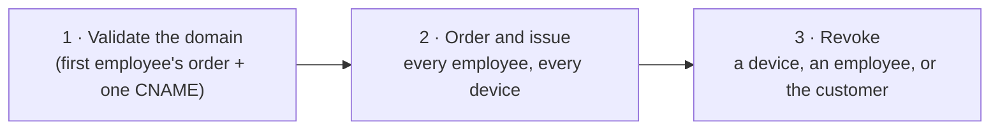

# SSL.com mailbox S/MIME integration demo

A small Python reference integration that orders, issues and revokes
**mailbox-validated S/MIME certificates** through the SSL.com **SWS API**, for a
partner that serves organizations: every employee gets certificates for their
devices, and the partner's backend does all the work through one SSL.com account.

Every API call in this repository has been exercised against the SSL.com sandbox
(`https://sws-test.sslpki.com`).

## The API contract: `docs/API_GUIDE.md`

**Start here if you are integrating with the API, whether or not you use this code.**
[`docs/API_GUIDE.md`](docs/API_GUIDE.md) is the API contract for mailbox-validated
S/MIME: it documents each call exactly as the SSL.com sandbox behaves, not as the
public Swagger spec describes it. It covers:

- **Both workflows, step by step**: validating an organization's domain once and
  then issuing for every employee, and issuing for one person through an activation
  link. Every step shows the real request as a ready-to-edit `curl` command and the
  real response the sandbox returned.
- **What to send**, including fields the Swagger spec omits (`recipient`,
  `POST /generate_certificate`) and the placeholder city and state some orders need.
- **How to read responses**: order status values, multi-certificate orders, and the
  error bodies that arrive with HTTP 200.
- **Reference**: the issued certificate profile, the activation email and page, and
  every difference from the Swagger spec.

The raw requests and responses behind every example are in
[`docs/examples/`](docs/examples/) as JSON, one file per call. The code in
`src/smime_demo/client.py` implements exactly the calls the guide documents, and no
others.

## Two ways to prove control of the mailboxes

| | Domain validated once (recommended for organizations) | Activation link per mailbox |
|---|---|---|
| Who acts | The customer's DNS admin publishes **one** CNAME record, once | Each employee opens an email and presses **Confirm** |
| Per-employee effort | None | One confirmation per employee |
| Commands | `domain validate`, then `customer onboard` | `customer onboard --mailbox-links`, `issue`, `multi-device` |

Either way, **private keys stay on the device**: the partner submits CSRs. A
device can supply its own CSR (a YubiKey or phone), or the demo can generate a
key for it.



## Prerequisites

- Python 3.11 or later, and `openssl` if you want to try a CSR made outside the demo.
- A sandbox account at <https://sandbox.ssl.com/users/new> and its **API credentials**
  (account key and secret key, from the account's API credentials page).
- For the domain path: an email domain whose DNS you can change (a test subdomain
  is fine; the addresses on it do not need to exist).
- For the activation-link path: a mailbox you can read.

## Install

```bash
git clone <this repository> smime_demonstration && cd smime_demonstration
python3 -m venv .venv && . .venv/bin/activate
pip install -e '.[dev]'
cp .env.example .env    # then fill in the credentials and test settings
smime-demo check
```

## Quickstart: an organization, domain validated once

```bash
cp examples/roster.example.csv roster.csv        # change the addresses to your test domain
smime-demo domain validate acme --employees roster.csv --domain your-test-domain.example \
    --locality Houston --state Texas             # publish the CNAME it prints; it waits
smime-demo customer onboard acme --employees roster.csv
smime-demo customer status acme
smime-demo customer offboard acme --employee bob --reason CESSATIONOFOPERATION
```

What happens:

1. **`domain validate`** orders the first employee's certificate (nothing is issued
   yet), prints a CNAME record, waits until it resolves, asks SSL.com to check it,
   and waits until the domain is validated. The record can be removed afterwards;
   the account keeps the validation.
2. **`customer onboard`** orders a certificate for every employee and issues one per
   device, with no emails or clicks, verifies each certificate, and writes keys,
   certificates, chains and (for a shared RSA key) a password-protected PKCS#12 under
   `out/customers/<customer>/<employee>/`. Running it again issues nothing twice.
3. **`customer offboard`** revokes one device (`--serial`), one employee
   (`--employee`), or the whole customer; **`customer status`** lists every
   certificate on the customer's orders and flags any the partner did not request.

`--locality` and `--state` are required by the API but never appear in the
certificates, so **placeholder values are fine**. They are needed on the domain path
and whenever an order holds more than one certificate (see
[Placeholder city and state](docs/API_GUIDE.md#placeholder-city-and-state)). They can
also come from `SSLCOM_REGISTRANT_LOCALITY` and `SSLCOM_REGISTRANT_STATE`.

## Quickstart: one person, activation link

```bash
smime-demo issue --external-id demo-1 --generate ecc        # SSLCOM_TEST_EMAIL gets a link
smime-demo multi-device --external-id demo-2 --locality Houston --state Texas  # phone, laptop, shared RSA
smime-demo revoke <ref> --reason CESSATIONOFOPERATION
```

The command waits while SSL.com emails the activation link. Open it, press
**Confirm**, and close the page; do not generate a certificate there. The demo
notices the confirmation and issues through the API.

## Roster format

```csv
employee_id,email,devices
alice,alice@example.com,phone:ecc;laptop:ecc;shared:rsa
bob,bob@example.com,laptop:ecc;yubikey:csr=bob-yubikey.csr
```

Each device is `name:ecc` (ECC P-256, signing only), `name:rsa` (RSA 3072, signing
and encryption), or `name:csr=<path>` (a CSR generated on the device; the path is
relative to the roster). SSL.com does not issue encryption-only certificates.

## CLI reference

| Command | What it does |
|---|---|
| `check` | Confirm the credentials and environment |
| `domain validate CUSTOMER --employees FILE [--domain D] --locality L --state S` | Step 1: validate the customer's domain on the first employee's order |
| `customer onboard CUSTOMER --employees FILE [--mailbox-links]` | Step 2: order and issue for every employee and device |
| `customer offboard CUSTOMER [--employee E \| --serial S] --reason R` | Step 3: revoke |
| `customer status CUSTOMER` | Inventory of every certificate on the customer's orders |
| `issue --external-id X (--generate ecc\|rsa \| --csr FILE) [--email E]` | One certificate, activation link |
| `multi-device --external-id X --locality L --state S [--email E]` | Phone, laptop and shared RSA certificates on one order |
| `status REF` / `download REF` / `revoke REF --reason R [--serial S]` | Single calls |

Global options: `--state-file` (default `out/state.json`), `--out` (default `out`),
`-v` to log every API call with credentials redacted. Revocation reasons:
`UNSPECIFIED`, `CESSATIONOFOPERATION`, `AFFILIATIONCHANGED`, `SUPERSEDED`,
`KEYCOMPROMISE`.

The demo talks to the sandbox unless `SSLCOM_ENV=production` **and**
`--i-understand-this-spends-money` are both given; production orders are charged.

## Tests

```bash
ruff check .
pytest -m "not live"      # offline: recorded sandbox responses and an in-memory SWS stand-in
```

`scripts/probe_contract.py` and `scripts/probe_domain_validation.py` are the
attended probes that produced the recorded responses in `tests/fixtures/sandbox/`.
The examples in the API guide were recorded with `smime-demo --record DIR …` and
rendered by `scripts/build_api_guide.py`.

## Layout

```
src/smime_demo/
  client.py        one method per SWS call
  errors.py        SwsError: every error shape the API returns, including HTTP 200 errors
  models.py        Order, CertificateBundle, CnameRecord, observed status values
  keys.py          keys, CSRs, PKCS#12
  verify.py        checks an issued certificate against its CSR, mailbox and chain
  store.py         local JSON state (stand-in for the partner database)
  roster.py        employees and devices from CSV
  workflows/       domain.py (step 1), enterprise.py (steps 2-3), single.py, multi_device.py
  recording.py     saves each request/response (credentials replaced) for documentation
  cli.py
docs/
  API_GUIDE.md     every workflow, call by call, with real requests and responses
  examples/        those requests and responses as JSON
  PRODUCTION_NOTES.md, openapi.json (the public Swagger spec, for reference)
```

Further reading: [`docs/API_GUIDE.md`](docs/API_GUIDE.md) shows each flow as a
sequence diagram followed by every call as a `curl` command with its real response,
and [`docs/PRODUCTION_NOTES.md`](docs/PRODUCTION_NOTES.md) lists what a production
integration must add.
