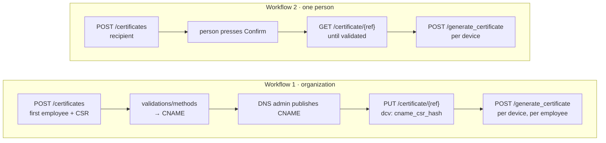
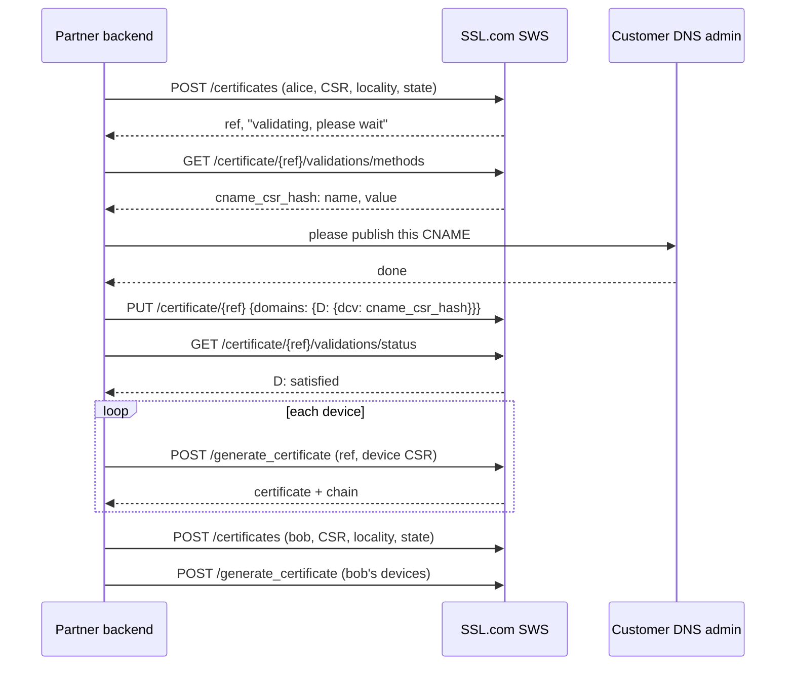
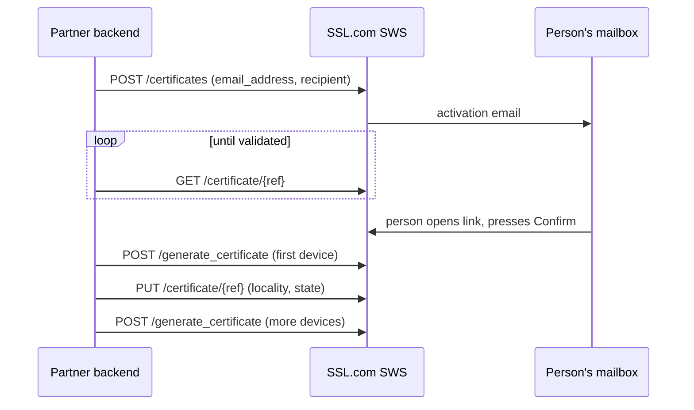

# SWS API guide: mailbox-validated S/MIME, step by step

This guide shows how to order, issue and revoke mailbox-validated S/MIME
certificates with the SSL.com SWS API. **Every example is a real call made
against the SSL.com sandbox**, recorded by this repository's code and reproduced
in full. The only changes are noted below.

- **Base URL:** `https://sws-test.sslpki.com` (sandbox); `https://sws.sslpki.com`
  (production, where every new order is charged).
- **Authentication:** `account_key` and `secret_key` as query parameters on every
  call. The examples show `YOUR_ACCOUNT_KEY` and `YOUR_SECRET_KEY`.
- **What has been changed in the examples:** credentials are placeholders; the
  account's team ID in portal URLs reads `YOUR_TEAM`; the mailbox in the
  activation-link workflow is shown as `jane.doe@example.com`; and every PEM block
  (certificates and CSRs) is shortened to its first characters. Everything else (refs,
  serial numbers, dates, statuses, timings) is exactly what the sandbox returned. The
  raw files are in [`examples/`](examples/).
- **Check the body, not just the status.** Many errors come back as HTTP 200 with an
  error body. See [Errors](#errors).

## Contents

1. [Organization: validate the domain once, then issue without clicks](#workflow-1-organization-domain-validated-once)
2. [One person: the mailbox owner confirms an activation link](#workflow-2-one-person-activation-link)
3. [Placeholder city and state](#placeholder-city-and-state)
4. [Other calls](#other-calls)
5. [Errors](#errors)
6. [Reference: statuses, issued certificates, emails, differences from the Swagger spec](#reference)



---

## Workflow 1: Organization, domain validated once

For a customer whose employees all have addresses on one domain. The customer's
DNS admin publishes **one** DNS record, once; after that, certificates for any
address on the domain are issued with no emails and no clicks, including several
devices per person.

In this run the customer's domain is `smimedemo-globex.sslcom.link`, with two
employees: alice (phone, laptop, and a shared RSA key) and bob (laptop, plus a
YubiKey that generated its own key and CSR).



### Step 1. Validate the domain

**1a. Order the first employee's certificate.** It must carry the first device's
CSR (the DNS record is derived from it) and a city and state (see
[Placeholder city and state](#placeholder-city-and-state)). `recipient` names the
person the certificate is for. Nothing is issued in this step.

<!-- example: domain/01_order_first_employee -->
`POST /certificates` — [domain/01_order_first_employee.json](examples/domain/01_order_first_employee.json)

```bash
curl -sS -X POST "https://sws-test.sslpki.com/certificates?account_key=YOUR_ACCOUNT_KEY&secret_key=YOUR_SECRET_KEY" \
  -H 'Content-Type: application/json' -d @- <<'JSON'
{
  "product": 300,
  "period": 365,
  "email_address": "alice@smimedemo-globex.sslcom.link",
  "recipient": {
    "email": "alice@smimedemo-globex.sslcom.link"
  },
  "external_order_number": "globex-alice",
  "csr": "-----BEGIN CERTIFICATE REQUEST-----\nMIIBKTCBzwIBADAtMSswKQYD...(shortened)\n-----END CERTIFICATE REQUEST-----\n",
  "locality": "Houston",
  "state_or_province": "Texas"
}
JSON
```

Response: HTTP 200 (4.91 s)

```json
{
  "ref": "co-7f1lg19kfaa",
  "registrant": {
    "organization": null,
    "organization_unit": null,
    "street_address_1": null,
    "street_address_2": null,
    "street_address_3": null,
    "locality": "Houston",
    "state_or_province": "Texas",
    "post_office_box": null,
    "postal_code": null,
    "country": null,
    "email": "alice@smimedemo-globex.sslcom.link",
    "assumed_name": null,
    "company_number": null,
    "business_category": null,
    "organization_identifier": null,
    "duns_number": null,
    "incorporation_country": null,
    "incorporation_date": null,
    "incorporation_state": null,
    "incorporation_city": null
  },
  "order_status": "validating, please wait",
  "validations": null,
  "order_amount": "$30.00",
  "external_order_number": "globex-alice",
  "certificate_url": "https://sandbox.ssl.com/team/YOUR_TEAM/certificate_orders/co-7f1lg19kfaa",
  "receipt_url": "https://sandbox.ssl.com/team/YOUR_TEAM/orders/00ac-1lg19kf",
  "smart_seal_url": "https://sandbox.ssl.com/team/YOUR_TEAM/certificate_orders/co-7f1lg19kfaa/site_seal",
  "validation_url": "https://sandbox.ssl.com/team/YOUR_TEAM/certificate_orders/co-7f1lg19kfaa/validation",
  "certificates": null,
  "certificate_contents": {
    "ref": "co-7f1lg19kfaa-0"
  }
}
```
<!-- /example -->

**1b. Ask which DNS record proves control of the domain.** Use the
`cname_csr_hash` entry for the domain. Its name and value come from the CSR on
the order, and the value includes the date: always read it, never construct it.

<!-- example: domain/02_validation_methods -->
`GET /certificate/co-7f1lg19kfaa/validations/methods` — [domain/02_validation_methods.json](examples/domain/02_validation_methods.json)

```bash
curl -sS -X GET "https://sws-test.sslpki.com/certificate/co-7f1lg19kfaa/validations/methods?account_key=YOUR_ACCOUNT_KEY&secret_key=YOUR_SECRET_KEY"
```

Response: HTTP 200 (0.28 s)

```json
{
  "instructions": "https://www.ssl.com/faqs/ssl-dv-validation-requirements/",
  "md5_hash": "2E1BFB721414C711774D13926FB863F1",
  "sha2_hash": "AFDB9CCD66973741636D168E5A35979D305F2D815549E936A8653F9B70327B79",
  "dns_sha2_hash": "AFDB9CCD66973741636D168E5A35979D.305F2D815549E936A8653F9B70327B79.20261120",
  "dcv_methods": {
    "smimedemo-globex.sslcom.link": {
      "email_addresses": [
        "admin@sslcom.link",
        "administrator@sslcom.link",
        "webmaster@sslcom.link",
        "hostmaster@sslcom.link",
        "postmaster@sslcom.link",
        "admin@smimedemo-globex.sslcom.link",
        "administrator@smimedemo-globex.sslcom.link",
        "webmaster@smimedemo-globex.sslcom.link",
        "hostmaster@smimedemo-globex.sslcom.link",
        "postmaster@smimedemo-globex.sslcom.link"
      ],
      "http_csr_hash": {
        "http": "http://smimedemo-globex.sslcom.link/.well-known/pki-validation/2E1BFB721414C711774D13926FB863F1.txt",
        "allow_https": "true",
        "contents": "AFDB9CCD66973741636D168E5A35979D305F2D815549E936A8653F9B70327B79\nssl.com\n20261120"
      },
      "cname_csr_hash": {
        "cname": "_2E1BFB721414C711774D13926FB863F1.smimedemo-globex.sslcom.link. CNAME AFDB9CCD66973741636D168E5A35979D.305F2D815549E936A8653F9B70327B79.20261120.ssl.com",
        "name": "_2E1BFB721414C711774D13926FB863F1.smimedemo-globex.sslcom.link",
        "value": "AFDB9CCD66973741636D168E5A35979D.305F2D815549E936A8653F9B70327B79.20261120.ssl.com"
      }
    },
    "alice@smimedemo-globex.sslcom.link": {
      "http_csr_hash": {
        "http": "http://alice@smimedemo-globex.sslcom.link/.well-known/pki-validation/2E1BFB721414C711774D13926FB863F1.txt",
        "allow_https": "true",
        "contents": "AFDB9CCD66973741636D168E5A35979D305F2D815549E936A8653F9B70327B79\nssl.com\n20261120"
      },
      "cname_csr_hash": {
        "cname": "_2E1BFB721414C711774D13926FB863F1.alice@smimedemo-globex.sslcom.link. CNAME AFDB9CCD66973741636D168E5A35979D.305F2D815549E936A8653F9B70327B79.20261120.ssl.com",
        "name": "_2E1BFB721414C711774D13926FB863F1.alice@smimedemo-globex.sslcom.link",
        "value": "AFDB9CCD66973741636D168E5A35979D.305F2D815549E936A8653F9B70327B79.20261120.ssl.com"
      }
    }
  },
  "ca_tag": "ssl.com"
}
```
<!-- /example -->

**1c. The customer's DNS admin publishes the record**, exactly as returned:

```
_2E1BFB721414C711774D13926FB863F1.smimedemo-globex.sslcom.link.  CNAME  AFDB9CCD66973741636D168E5A35979D.305F2D815549E936A8653F9B70327B79.20261120.ssl.com.
```

**1d. Once it resolves, ask SSL.com to check it.**

<!-- example: domain/03_choose_cname_validation -->
`PUT /certificate/co-7f1lg19kfaa` — [domain/03_choose_cname_validation.json](examples/domain/03_choose_cname_validation.json)

```bash
curl -sS -X PUT "https://sws-test.sslpki.com/certificate/co-7f1lg19kfaa?account_key=YOUR_ACCOUNT_KEY&secret_key=YOUR_SECRET_KEY" \
  -H 'Content-Type: application/json' -d @- <<'JSON'
{
  "domains": {
    "smimedemo-globex.sslcom.link": {
      "dcv": "cname_csr_hash"
    }
  }
}
JSON
```

Response: HTTP 200 (1.73 s)

```json
{
  "ref": "co-7f1lg19kfaa",
  "registrant": {
    "organization": null,
    "organization_unit": null,
    "street_address_1": null,
    "street_address_2": null,
    "street_address_3": null,
    "locality": "Houston",
    "state_or_province": "Texas",
    "post_office_box": null,
    "postal_code": null,
    "country": null,
    "email": "alice@smimedemo-globex.sslcom.link",
    "assumed_name": null,
    "company_number": null,
    "business_category": null,
    "organization_identifier": null,
    "duns_number": null,
    "incorporation_country": null,
    "incorporation_date": null,
    "incorporation_state": null,
    "incorporation_city": null
  },
  "order_status": "validating, please wait",
  "validations": null,
  "order_amount": "$30.00",
  "external_order_number": "globex-alice",
  "certificate_url": "https://sandbox.ssl.com/team/YOUR_TEAM/certificate_orders/co-7f1lg19kfaa",
  "receipt_url": "https://sandbox.ssl.com/team/YOUR_TEAM/orders/00ac-1lg19kf",
  "smart_seal_url": "https://sandbox.ssl.com/team/YOUR_TEAM/certificate_orders/co-7f1lg19kfaa/site_seal",
  "validation_url": "https://sandbox.ssl.com/team/YOUR_TEAM/certificate_orders/co-7f1lg19kfaa/validation",
  "certificates": null,
  "certificate_contents": {
    "ref": "co-7f1lg19kfaa-0"
  }
}
```
<!-- /example -->

**1e. Confirm the domain is `satisfied`.** In the sandbox it was satisfied
immediately. From here on the DNS record can be removed: the account keeps the
validation, and later orders for any address on the domain use it.

<!-- example: domain/04_validation_status -->
`GET /certificate/co-7f1lg19kfaa/validations/status` — [domain/04_validation_status.json](examples/domain/04_validation_status.json)

```bash
curl -sS -X GET "https://sws-test.sslpki.com/certificate/co-7f1lg19kfaa/validations/status?account_key=YOUR_ACCOUNT_KEY&secret_key=YOUR_SECRET_KEY"
```

Response: HTTP 200 (0.14 s)

```json
{
  "validation_status": {
    "smimedemo-globex.sslcom.link": {
      "method": "cname_csr_hash",
      "status": "satisfied",
      "validated_at": "2026-11-20T13:59:55.000-06:00"
    },
    "alice@smimedemo-globex.sslcom.link": {
      "method": null,
      "status": "not yet started"
    }
  }
}
```
<!-- /example -->

### Step 2. Issue certificates for every employee and device

The order's `order_status` still reads `validating, please wait` at this point;
the domain validation is applied when a certificate is requested. Do not wait
for `validated` on this path; go straight to `POST /generate_certificate`.

<!-- example: domain/05_order_status_before_issuing -->
`GET /certificate/co-7f1lg19kfaa` — [domain/05_order_status_before_issuing.json](examples/domain/05_order_status_before_issuing.json)

```bash
curl -sS -X GET "https://sws-test.sslpki.com/certificate/co-7f1lg19kfaa?response_type=individually&response_encoding=base64&account_key=YOUR_ACCOUNT_KEY&secret_key=YOUR_SECRET_KEY"
```

Response: HTTP 200 (0.84 s)

```json
{
  "description": "1 Year Personal Basic",
  "product": "300",
  "product_name": "personal-basic",
  "order_status": "validating, please wait",
  "order_date": "2026-11-20T13:59:11.000-06:00",
  "registrant": {
    "organization": null,
    "organization_unit": null,
    "street_address_1": null,
    "street_address_2": null,
    "street_address_3": null,
    "locality": "Houston",
    "state_or_province": "Texas",
    "post_office_box": null,
    "postal_code": null,
    "country": null,
    "email": "alice@smimedemo-globex.sslcom.link",
    "assumed_name": null,
    "company_number": null,
    "business_category": null,
    "organization_identifier": null,
    "duns_number": null,
    "incorporation_country": null,
    "incorporation_date": null,
    "incorporation_state": null,
    "incorporation_city": null
  },
  "special_fields": null,
  "certificates": null,
  "common_name": "alice@smimedemo-globex.sslcom.link",
  "serial_number": null,
  "domains_qty_purchased": "2",
  "wildcard_qty_purchased": "0",
  "subject_alternative_names": null,
  "validations": {
    "smimedemo-globex.sslcom.link": {
      "method": "cname_csr_hash",
      "status": "satisfied",
      "validated_at": "2026-11-20T13:59:55.000-06:00"
    },
    "alice@smimedemo-globex.sslcom.link": {
      "method": null,
      "status": "not yet started"
    }
  },
  "effective_date": null,
  "expiration_date": null,
  "algorithm": null,
  "external_order_number": "globex-alice",
  "domains": [
    "smimedemo-globex.sslcom.link",
    "alice@smimedemo-globex.sslcom.link"
  ],
  "site_seal_code": null,
  "subscriber_agreement": null,
  "server_software": 1,
  "contacts": [],
  "authorized_users": {
    "contract_signer": {},
    "contract_requestor": {},
    "contract_approver": {}
  },
  "end_entity_certificates": null
}
```
<!-- /example -->

**2a. Issue the first device's certificate** with the CSR sent in step 1a. The
response carries the certificate followed by the intermediate and root.

<!-- example: domain/06_issue_first_device -->
`POST /generate_certificate` — [domain/06_issue_first_device.json](examples/domain/06_issue_first_device.json)

```bash
curl -sS -X POST "https://sws-test.sslpki.com/generate_certificate?account_key=YOUR_ACCOUNT_KEY&secret_key=YOUR_SECRET_KEY" \
  -H 'Content-Type: application/json' -d @- <<'JSON'
{
  "ref": "co-7f1lg19kfaa",
  "csr": "-----BEGIN CERTIFICATE REQUEST-----\nMIIBKTCBzwIBADAtMSswKQYD...(shortened)\n-----END CERTIFICATE REQUEST-----\n"
}
JSON
```

Response: HTTP 200 (11.76 s)

```json
{
  "cert_results": "-----BEGIN CERTIFICATE-----\nMIIDkDCCAxegAwIBAgIQfYiH...(shortened)\n-----END CERTIFICATE-----\n-----BEGIN CERTIFICATE-----\nMIIDqTCCAy+gAwIBAgIQVnuC...(shortened)\n-----END CERTIFICATE-----\n-----BEGIN CERTIFICATE-----\nMIICrTCCAjKgAwIBAgIIPTUU...(shortened)\n-----END CERTIFICATE-----\n",
  "cert_common_name": "166862397752961560184429223278071606587.crt",
  "error_message": null
}
```
<!-- /example -->

**2b. Issue more devices on the same order**, each with its own CSR. No further
validation is needed.

<!-- example: domain/07_issue_another_device -->
`POST /generate_certificate` — [domain/07_issue_another_device.json](examples/domain/07_issue_another_device.json)

```bash
curl -sS -X POST "https://sws-test.sslpki.com/generate_certificate?account_key=YOUR_ACCOUNT_KEY&secret_key=YOUR_SECRET_KEY" \
  -H 'Content-Type: application/json' -d @- <<'JSON'
{
  "ref": "co-7f1lg19kfaa",
  "csr": "-----BEGIN CERTIFICATE REQUEST-----\nMIIBKDCBzwIBADAtMSswKQYD...(shortened)\n-----END CERTIFICATE REQUEST-----\n"
}
JSON
```

Response: HTTP 200 (6.97 s)

```json
{
  "cert_results": "-----BEGIN CERTIFICATE-----\nMIIDkDCCAxegAwIBAgIQPwwq...(shortened)\n-----END CERTIFICATE-----\n-----BEGIN CERTIFICATE-----\nMIIDqTCCAy+gAwIBAgIQVnuC...(shortened)\n-----END CERTIFICATE-----\n-----BEGIN CERTIFICATE-----\nMIICrTCCAjKgAwIBAgIIPTUU...(shortened)\n-----END CERTIFICATE-----\n",
  "cert_common_name": "83804530401728702974251840959265494238.crt",
  "error_message": null
}
```
<!-- /example -->

**2c. Order for the next employee.** Same fields as 1a: the first device's CSR,
plus the city and state. No DNS step this time.

<!-- example: domain/08_order_next_employee -->
`POST /certificates` — [domain/08_order_next_employee.json](examples/domain/08_order_next_employee.json)

```bash
curl -sS -X POST "https://sws-test.sslpki.com/certificates?account_key=YOUR_ACCOUNT_KEY&secret_key=YOUR_SECRET_KEY" \
  -H 'Content-Type: application/json' -d @- <<'JSON'
{
  "product": 300,
  "period": 365,
  "email_address": "bob@smimedemo-globex.sslcom.link",
  "recipient": {
    "email": "bob@smimedemo-globex.sslcom.link"
  },
  "external_order_number": "globex-bob",
  "csr": "-----BEGIN CERTIFICATE REQUEST-----\nMIIBJDCBywIBADArMSkwJwYD...(shortened)\n-----END CERTIFICATE REQUEST-----\n",
  "locality": "Houston",
  "state_or_province": "Texas"
}
JSON
```

Response: HTTP 200 (1.96 s)

```json
{
  "ref": "co-171lg19oh9a",
  "registrant": {
    "organization": null,
    "organization_unit": null,
    "street_address_1": null,
    "street_address_2": null,
    "street_address_3": null,
    "locality": "Houston",
    "state_or_province": "Texas",
    "post_office_box": null,
    "postal_code": null,
    "country": null,
    "email": "bob@smimedemo-globex.sslcom.link",
    "assumed_name": null,
    "company_number": null,
    "business_category": null,
    "organization_identifier": null,
    "duns_number": null,
    "incorporation_country": null,
    "incorporation_date": null,
    "incorporation_state": null,
    "incorporation_city": null
  },
  "order_status": "validating, please wait",
  "validations": null,
  "order_amount": "$30.00",
  "external_order_number": "globex-bob",
  "certificate_url": "https://sandbox.ssl.com/team/YOUR_TEAM/certificate_orders/co-171lg19oh9a",
  "receipt_url": "https://sandbox.ssl.com/team/YOUR_TEAM/orders/5a96-1lg19oh",
  "smart_seal_url": "https://sandbox.ssl.com/team/YOUR_TEAM/certificate_orders/co-171lg19oh9a/site_seal",
  "validation_url": "https://sandbox.ssl.com/team/YOUR_TEAM/certificate_orders/co-171lg19oh9a/validation",
  "certificates": null,
  "certificate_contents": {
    "ref": "co-171lg19oh9a-0"
  }
}
```
<!-- /example -->

**2d. Issue straight away.** No email, no click, no DNS change.

<!-- example: domain/09_issue_next_employee -->
`POST /generate_certificate` — [domain/09_issue_next_employee.json](examples/domain/09_issue_next_employee.json)

```bash
curl -sS -X POST "https://sws-test.sslpki.com/generate_certificate?account_key=YOUR_ACCOUNT_KEY&secret_key=YOUR_SECRET_KEY" \
  -H 'Content-Type: application/json' -d @- <<'JSON'
{
  "ref": "co-171lg19oh9a",
  "csr": "-----BEGIN CERTIFICATE REQUEST-----\nMIIBJDCBywIBADArMSkwJwYD...(shortened)\n-----END CERTIFICATE REQUEST-----\n"
}
JSON
```

Response: HTTP 200 (4.15 s)

```json
{
  "cert_results": "-----BEGIN CERTIFICATE-----\nMIIDjTCCAxOgAwIBAgIQe1Um...(shortened)\n-----END CERTIFICATE-----\n-----BEGIN CERTIFICATE-----\nMIIDqTCCAy+gAwIBAgIQVnuC...(shortened)\n-----END CERTIFICATE-----\n-----BEGIN CERTIFICATE-----\nMIICrTCCAjKgAwIBAgIIPTUU...(shortened)\n-----END CERTIFICATE-----\n",
  "cert_common_name": "163937161018719383775647491120673752101.crt",
  "error_message": null
}
```
<!-- /example -->

**2e. A device that generated its own key.** Bob's YubiKey made its key and CSR
(here with `openssl`); only the CSR is sent. It is the same call.

<!-- example: domain/10_issue_device_own_csr -->
`POST /generate_certificate` — [domain/10_issue_device_own_csr.json](examples/domain/10_issue_device_own_csr.json)

```bash
curl -sS -X POST "https://sws-test.sslpki.com/generate_certificate?account_key=YOUR_ACCOUNT_KEY&secret_key=YOUR_SECRET_KEY" \
  -H 'Content-Type: application/json' -d @- <<'JSON'
{
  "ref": "co-171lg19oh9a",
  "csr": "-----BEGIN CERTIFICATE REQUEST-----\nMIIBJTCBywIBADArMSkwJwYD...(shortened)\n-----END CERTIFICATE REQUEST-----\n"
}
JSON
```

Response: HTTP 200 (4.27 s)

```json
{
  "cert_results": "-----BEGIN CERTIFICATE-----\nMIIDjjCCAxOgAwIBAgIQPwXB...(shortened)\n-----END CERTIFICATE-----\n-----BEGIN CERTIFICATE-----\nMIIDqTCCAy+gAwIBAgIQVnuC...(shortened)\n-----END CERTIFICATE-----\n-----BEGIN CERTIFICATE-----\nMIICrTCCAjKgAwIBAgIIPTUU...(shortened)\n-----END CERTIFICATE-----\n",
  "cert_common_name": "83771254756217207762353065240899528544.crt",
  "error_message": null
}
```
<!-- /example -->

**2f. Read everything on an order.** `end_entity_certificates` lists every
certificate with its serial and status. `certificates`, `serial_number` and the
dates describe only the most recent one.

<!-- example: domain/11_order_with_three_certificates -->
`GET /certificate/co-7f1lg19kfaa` — [domain/11_order_with_three_certificates.json](examples/domain/11_order_with_three_certificates.json)

```bash
curl -sS -X GET "https://sws-test.sslpki.com/certificate/co-7f1lg19kfaa?response_type=individually&response_encoding=base64&account_key=YOUR_ACCOUNT_KEY&secret_key=YOUR_SECRET_KEY"
```

Response: HTTP 200 (0.24 s)

```json
{
  "description": "1 Year Personal Basic",
  "product": "300",
  "product_name": "personal-basic",
  "order_status": "issued",
  "order_date": "2026-11-20T13:59:11.000-06:00",
  "registrant": {
    "organization": null,
    "organization_unit": null,
    "street_address_1": null,
    "street_address_2": null,
    "street_address_3": null,
    "locality": "Houston",
    "state_or_province": "Texas",
    "post_office_box": null,
    "postal_code": null,
    "country": null,
    "email": "alice@smimedemo-globex.sslcom.link",
    "assumed_name": null,
    "company_number": null,
    "business_category": null,
    "organization_identifier": null,
    "duns_number": null,
    "incorporation_country": null,
    "incorporation_date": null,
    "incorporation_state": null,
    "incorporation_city": null
  },
  "special_fields": null,
  "certificates": "-----BEGIN CERTIFICATE-----\nMIIGfzCCBGegAwIBAgIQVsZr...(shortened)\n-----END CERTIFICATE-----\n-----BEGIN CERTIFICATE-----\nMIIG+jCCBOKgAwIBAgIQezPn...(shortened)\n-----END CERTIFICATE-----\n-----BEGIN CERTIFICATE-----\nMIIF+zCCA+OgAwIBAgIIIzOb...(shortened)\n-----END CERTIFICATE-----\n",
  "common_name": null,
  "serial_number": "56c66b35a9c9b025db862b86491e57b6",
  "domains_qty_purchased": "2",
  "wildcard_qty_purchased": "0",
  "subject_alternative_names": [],
  "validations": {
    "smimedemo-globex.sslcom.link": {
      "method": "cname_csr_hash",
      "status": "satisfied",
      "validated_at": "2026-11-20T13:59:55.000-06:00"
    },
    "alice@smimedemo-globex.sslcom.link": {
      "method": null,
      "status": "not yet started"
    }
  },
  "effective_date": "2026-11-20T13:51:16.000-06:00",
  "expiration_date": "2027-11-19T13:51:16.000-06:00",
  "algorithm": "SHA256",
  "external_order_number": "globex-alice",
  "domains": [
    "smimedemo-globex.sslcom.link",
    "alice@smimedemo-globex.sslcom.link"
  ],
  "site_seal_code": null,
  "subscriber_agreement": null,
  "server_software": 1,
  "contacts": [],
  "authorized_users": {
    "contract_signer": {},
    "contract_requestor": {},
    "contract_approver": {}
  },
  "end_entity_certificates": [
    {
      "certificate": "-----BEGIN CERTIFICATE-----\nMIIDkDCCAxegAwIBAgIQfYiH...(shortened)\n-----END CERTIFICATE-----\n-----BEGIN CERTIFICATE-----\nMIIDqTCCAy+gAwIBAgIQVnuC...(shortened)\n-----END CERTIFICATE-----\n-----BEGIN CERTIFICATE-----\nMIICrTCCAjKgAwIBAgIIPTUU...(shortened)\n-----END CERTIFICATE-----\n",
      "serial": "7d8887623851b12821daf98789a96d3b",
      "status": "issued"
    },
    {
      "certificate": "-----BEGIN CERTIFICATE-----\nMIIDkDCCAxegAwIBAgIQPwwq...(shortened)\n-----END CERTIFICATE-----\n-----BEGIN CERTIFICATE-----\nMIIDqTCCAy+gAwIBAgIQVnuC...(shortened)\n-----END CERTIFICATE-----\n-----BEGIN CERTIFICATE-----\nMIICrTCCAjKgAwIBAgIIPTUU...(shortened)\n-----END CERTIFICATE-----\n",
      "serial": "3f0c2a5b6de4c76af80b0bddbe21d4de",
      "status": "issued"
    },
    {
      "certificate": "-----BEGIN CERTIFICATE-----\nMIIGfzCCBGegAwIBAgIQVsZr...(shortened)\n-----END CERTIFICATE-----\n-----BEGIN CERTIFICATE-----\nMIIG+jCCBOKgAwIBAgIQezPn...(shortened)\n-----END CERTIFICATE-----\n-----BEGIN CERTIFICATE-----\nMIIF+zCCA+OgAwIBAgIIIzOb...(shortened)\n-----END CERTIFICATE-----\n",
      "serial": "56c66b35a9c9b025db862b86491e57b6",
      "status": "issued"
    }
  ]
}
```
<!-- /example -->

### Step 3. Revoke certificates that are no longer needed

**3a. One device** (lost or replaced): pass the certificate's `serial` exactly as
`end_entity_certificates` shows it (lowercase hex, no colons).

<!-- example: domain/12_revoke_one_certificate -->
`DELETE /certificate/co-7f1lg19kfaa` — [domain/12_revoke_one_certificate.json](examples/domain/12_revoke_one_certificate.json)

```bash
curl -sS -X DELETE "https://sws-test.sslpki.com/certificate/co-7f1lg19kfaa?reason=SUPERSEDED&serials=3f0c2a5b6de4c76af80b0bddbe21d4de&account_key=YOUR_ACCOUNT_KEY&secret_key=YOUR_SECRET_KEY"
```

Response: HTTP 200 (1.34 s)

```json
{
  "status": "revoked"
}
```
<!-- /example -->

Only that certificate is revoked. The order's `order_status` stays `issued`, so
read per-certificate status from `end_entity_certificates`:

<!-- example: domain/13_after_revoking_one -->
`GET /certificate/co-7f1lg19kfaa` — [domain/13_after_revoking_one.json](examples/domain/13_after_revoking_one.json)

```bash
curl -sS -X GET "https://sws-test.sslpki.com/certificate/co-7f1lg19kfaa?response_type=individually&response_encoding=base64&account_key=YOUR_ACCOUNT_KEY&secret_key=YOUR_SECRET_KEY"
```

Response: HTTP 200 (0.21 s)

```json
{
  "description": "1 Year Personal Basic",
  "product": "300",
  "product_name": "personal-basic",
  "order_status": "issued",
  "order_date": "2026-11-20T13:59:11.000-06:00",
  "registrant": {
    "organization": null,
    "organization_unit": null,
    "street_address_1": null,
    "street_address_2": null,
    "street_address_3": null,
    "locality": "Houston",
    "state_or_province": "Texas",
    "post_office_box": null,
    "postal_code": null,
    "country": null,
    "email": "alice@smimedemo-globex.sslcom.link",
    "assumed_name": null,
    "company_number": null,
    "business_category": null,
    "organization_identifier": null,
    "duns_number": null,
    "incorporation_country": null,
    "incorporation_date": null,
    "incorporation_state": null,
    "incorporation_city": null
  },
  "special_fields": null,
  "certificates": "-----BEGIN CERTIFICATE-----\nMIIGfzCCBGegAwIBAgIQVsZr...(shortened)\n-----END CERTIFICATE-----\n-----BEGIN CERTIFICATE-----\nMIIG+jCCBOKgAwIBAgIQezPn...(shortened)\n-----END CERTIFICATE-----\n-----BEGIN CERTIFICATE-----\nMIIF+zCCA+OgAwIBAgIIIzOb...(shortened)\n-----END CERTIFICATE-----\n",
  "common_name": null,
  "serial_number": "56c66b35a9c9b025db862b86491e57b6",
  "domains_qty_purchased": "2",
  "wildcard_qty_purchased": "0",
  "subject_alternative_names": [],
  "validations": {
    "smimedemo-globex.sslcom.link": {
      "method": "cname_csr_hash",
      "status": "satisfied",
      "validated_at": "2026-11-20T13:59:55.000-06:00"
    },
    "alice@smimedemo-globex.sslcom.link": {
      "method": null,
      "status": "not yet started"
    }
  },
  "effective_date": "2026-11-20T13:51:16.000-06:00",
  "expiration_date": "2027-11-19T13:51:16.000-06:00",
  "algorithm": "SHA256",
  "external_order_number": "globex-alice",
  "domains": [
    "smimedemo-globex.sslcom.link",
    "alice@smimedemo-globex.sslcom.link"
  ],
  "site_seal_code": null,
  "subscriber_agreement": null,
  "server_software": 1,
  "contacts": [],
  "authorized_users": {
    "contract_signer": {},
    "contract_requestor": {},
    "contract_approver": {}
  },
  "end_entity_certificates": [
    {
      "certificate": "-----BEGIN CERTIFICATE-----\nMIIDkDCCAxegAwIBAgIQfYiH...(shortened)\n-----END CERTIFICATE-----\n-----BEGIN CERTIFICATE-----\nMIIDqTCCAy+gAwIBAgIQVnuC...(shortened)\n-----END CERTIFICATE-----\n-----BEGIN CERTIFICATE-----\nMIICrTCCAjKgAwIBAgIIPTUU...(shortened)\n-----END CERTIFICATE-----\n",
      "serial": "7d8887623851b12821daf98789a96d3b",
      "status": "issued"
    },
    {
      "certificate": "-----BEGIN CERTIFICATE-----\nMIIDkDCCAxegAwIBAgIQPwwq...(shortened)\n-----END CERTIFICATE-----\n-----BEGIN CERTIFICATE-----\nMIIDqTCCAy+gAwIBAgIQVnuC...(shortened)\n-----END CERTIFICATE-----\n-----BEGIN CERTIFICATE-----\nMIICrTCCAjKgAwIBAgIIPTUU...(shortened)\n-----END CERTIFICATE-----\n",
      "serial": "3f0c2a5b6de4c76af80b0bddbe21d4de",
      "status": "revoked"
    },
    {
      "certificate": "-----BEGIN CERTIFICATE-----\nMIIGfzCCBGegAwIBAgIQVsZr...(shortened)\n-----END CERTIFICATE-----\n-----BEGIN CERTIFICATE-----\nMIIG+jCCBOKgAwIBAgIQezPn...(shortened)\n-----END CERTIFICATE-----\n-----BEGIN CERTIFICATE-----\nMIIF+zCCA+OgAwIBAgIIIzOb...(shortened)\n-----END CERTIFICATE-----\n",
      "serial": "56c66b35a9c9b025db862b86491e57b6",
      "status": "issued"
    }
  ]
}
```
<!-- /example -->

**3b. One employee** (leaves the customer): revoke the whole order.

<!-- example: domain/14_revoke_employee -->
`DELETE /certificate/co-171lg19oh9a` — [domain/14_revoke_employee.json](examples/domain/14_revoke_employee.json)

```bash
curl -sS -X DELETE "https://sws-test.sslpki.com/certificate/co-171lg19oh9a?reason=CESSATIONOFOPERATION&account_key=YOUR_ACCOUNT_KEY&secret_key=YOUR_SECRET_KEY"
```

Response: HTTP 200 (0.94 s)

```json
{
  "status": "revoked"
}
```
<!-- /example -->

<!-- example: domain/15_after_revoking_employee -->
`GET /certificate/co-171lg19oh9a` — [domain/15_after_revoking_employee.json](examples/domain/15_after_revoking_employee.json)

```bash
curl -sS -X GET "https://sws-test.sslpki.com/certificate/co-171lg19oh9a?response_type=individually&response_encoding=base64&account_key=YOUR_ACCOUNT_KEY&secret_key=YOUR_SECRET_KEY"
```

Response: HTTP 200 (0.17 s)

```json
{
  "description": "1 Year Personal Basic",
  "product": "300",
  "product_name": "personal-basic",
  "order_status": "revoked",
  "order_date": "2026-11-20T14:01:21.000-06:00",
  "registrant": {
    "organization": null,
    "organization_unit": null,
    "street_address_1": null,
    "street_address_2": null,
    "street_address_3": null,
    "locality": "Houston",
    "state_or_province": "Texas",
    "post_office_box": null,
    "postal_code": null,
    "country": null,
    "email": "bob@smimedemo-globex.sslcom.link",
    "assumed_name": null,
    "company_number": null,
    "business_category": null,
    "organization_identifier": null,
    "duns_number": null,
    "incorporation_country": null,
    "incorporation_date": null,
    "incorporation_state": null,
    "incorporation_city": null
  },
  "special_fields": null,
  "certificates": "-----BEGIN CERTIFICATE-----\nMIIDjjCCAxOgAwIBAgIQPwXB...(shortened)\n-----END CERTIFICATE-----\n-----BEGIN CERTIFICATE-----\nMIIDqTCCAy+gAwIBAgIQVnuC...(shortened)\n-----END CERTIFICATE-----\n-----BEGIN CERTIFICATE-----\nMIICrTCCAjKgAwIBAgIIPTUU...(shortened)\n-----END CERTIFICATE-----\n",
  "common_name": null,
  "serial_number": "3f05c1bdbc5f7ba34fbde5baa662a760",
  "domains_qty_purchased": "2",
  "wildcard_qty_purchased": "0",
  "subject_alternative_names": [],
  "validations": {
    "smimedemo-globex.sslcom.link": {
      "method": "cname_csr_hash",
      "status": "satisfied",
      "validated_at": "2026-11-20T13:59:55.000-06:00"
    },
    "bob@smimedemo-globex.sslcom.link": {
      "method": null,
      "status": "not yet started"
    }
  },
  "effective_date": "2026-11-20T13:51:28.000-06:00",
  "expiration_date": "2027-11-19T13:51:28.000-06:00",
  "algorithm": "SHA1",
  "external_order_number": "globex-bob",
  "domains": [
    "smimedemo-globex.sslcom.link",
    "bob@smimedemo-globex.sslcom.link"
  ],
  "site_seal_code": null,
  "subscriber_agreement": null,
  "server_software": 1,
  "contacts": [],
  "authorized_users": {
    "contract_signer": {},
    "contract_requestor": {},
    "contract_approver": {}
  },
  "end_entity_certificates": [
    {
      "certificate": "-----BEGIN CERTIFICATE-----\nMIIDjTCCAxOgAwIBAgIQe1Um...(shortened)\n-----END CERTIFICATE-----\n-----BEGIN CERTIFICATE-----\nMIIDqTCCAy+gAwIBAgIQVnuC...(shortened)\n-----END CERTIFICATE-----\n-----BEGIN CERTIFICATE-----\nMIICrTCCAjKgAwIBAgIIPTUU...(shortened)\n-----END CERTIFICATE-----\n",
      "serial": "7b552613d974a15c0fe12171f3168425",
      "status": "revoked"
    },
    {
      "certificate": "-----BEGIN CERTIFICATE-----\nMIIDjjCCAxOgAwIBAgIQPwXB...(shortened)\n-----END CERTIFICATE-----\n-----BEGIN CERTIFICATE-----\nMIIDqTCCAy+gAwIBAgIQVnuC...(shortened)\n-----END CERTIFICATE-----\n-----BEGIN CERTIFICATE-----\nMIICrTCCAjKgAwIBAgIIPTUU...(shortened)\n-----END CERTIFICATE-----\n",
      "serial": "3f05c1bdbc5f7ba34fbde5baa662a760",
      "status": "revoked"
    }
  ]
}
```
<!-- /example -->

**3c. The whole customer**: revoke each employee's order the same way.

---

## Workflow 2: One person, activation link

For a single person, or a customer whose domain cannot be validated. SSL.com
emails the mailbox an activation link; the person opens it and presses
**Confirm**. Here: one person with a phone, a laptop and a shared RSA key.



**1. Order.** `recipient` is what makes SSL.com send the activation email. No CSR
is needed here.

<!-- example: mailbox/01_order -->
`POST /certificates` — [mailbox/01_order.json](examples/mailbox/01_order.json)

```bash
curl -sS -X POST "https://sws-test.sslpki.com/certificates?account_key=YOUR_ACCOUNT_KEY&secret_key=YOUR_SECRET_KEY" \
  -H 'Content-Type: application/json' -d @- <<'JSON'
{
  "product": 300,
  "period": 365,
  "email_address": "jane.doe@example.com",
  "recipient": {
    "email": "jane.doe@example.com"
  },
  "external_order_number": "individual-guide-mailbox-1"
}
JSON
```

Response: HTTP 200 (4.15 s)

```json
{
  "ref": "co-cb1lg19qlff",
  "registrant": {
    "organization": null,
    "organization_unit": null,
    "street_address_1": null,
    "street_address_2": null,
    "street_address_3": null,
    "locality": null,
    "state_or_province": null,
    "post_office_box": null,
    "postal_code": null,
    "country": null,
    "email": "jane.doe@example.com",
    "assumed_name": null,
    "company_number": null,
    "business_category": null,
    "organization_identifier": null,
    "duns_number": null,
    "incorporation_country": null,
    "incorporation_date": null,
    "incorporation_state": null,
    "incorporation_city": null
  },
  "order_status": "validating, please wait",
  "validations": null,
  "order_amount": "$30.00",
  "external_order_number": "individual-guide-mailbox-1",
  "certificate_url": "https://sandbox.ssl.com/team/YOUR_TEAM/certificate_orders/co-cb1lg19qlff",
  "receipt_url": "https://sandbox.ssl.com/team/YOUR_TEAM/orders/4d38-1lg19ql",
  "smart_seal_url": "https://sandbox.ssl.com/team/YOUR_TEAM/certificate_orders/co-cb1lg19qlff/site_seal",
  "validation_url": "https://sandbox.ssl.com/team/YOUR_TEAM/certificate_orders/co-cb1lg19qlff/validation",
  "certificates": null,
  "certificate_contents": {
    "ref": "co-cb1lg19qlff-0"
  }
}
```
<!-- /example -->

**2. Poll while the person confirms.** The status reads `validating, please wait`
until they press Confirm on the activation page:

<!-- example: mailbox/02_waiting_for_confirmation -->
`GET /certificate/co-cb1lg19qlff` — [mailbox/02_waiting_for_confirmation.json](examples/mailbox/02_waiting_for_confirmation.json)

```bash
curl -sS -X GET "https://sws-test.sslpki.com/certificate/co-cb1lg19qlff?response_type=individually&response_encoding=base64&account_key=YOUR_ACCOUNT_KEY&secret_key=YOUR_SECRET_KEY"
```

Response: HTTP 200 (0.17 s)

```json
{
  "description": "1 Year Personal Basic",
  "product": "300",
  "product_name": "personal-basic",
  "order_status": "validating, please wait",
  "order_date": "2026-11-20T14:02:29.000-06:00",
  "registrant": {
    "organization": null,
    "organization_unit": null,
    "street_address_1": null,
    "street_address_2": null,
    "street_address_3": null,
    "locality": null,
    "state_or_province": null,
    "post_office_box": null,
    "postal_code": null,
    "country": null,
    "email": "jane.doe@example.com",
    "assumed_name": null,
    "company_number": null,
    "business_category": null,
    "organization_identifier": null,
    "duns_number": null,
    "incorporation_country": null,
    "incorporation_date": null,
    "incorporation_state": null,
    "incorporation_city": null
  },
  "special_fields": null,
  "certificates": null,
  "common_name": null,
  "serial_number": null,
  "domains_qty_purchased": "1",
  "wildcard_qty_purchased": "0",
  "subject_alternative_names": null,
  "validations": {
    "example.com": {
      "method": null,
      "status": "not yet started"
    }
  },
  "effective_date": null,
  "expiration_date": null,
  "algorithm": null,
  "external_order_number": "individual-guide-mailbox-1",
  "domains": [
    "example.com"
  ],
  "site_seal_code": null,
  "subscriber_agreement": null,
  "server_software": 1,
  "contacts": [],
  "authorized_users": {
    "contract_signer": {},
    "contract_requestor": {},
    "contract_approver": {}
  },
  "end_entity_certificates": null
}
```
<!-- /example -->

…and `validated` afterwards:

<!-- example: mailbox/03_confirmed -->
`GET /certificate/co-cb1lg19qlff` — [mailbox/03_confirmed.json](examples/mailbox/03_confirmed.json)

```bash
curl -sS -X GET "https://sws-test.sslpki.com/certificate/co-cb1lg19qlff?response_type=individually&response_encoding=base64&account_key=YOUR_ACCOUNT_KEY&secret_key=YOUR_SECRET_KEY"
```

Response: HTTP 200 (0.52 s)

```json
{
  "description": "1 Year Personal Basic",
  "product": "300",
  "product_name": "personal-basic",
  "order_status": "validated",
  "order_date": "2026-11-20T14:02:29.000-06:00",
  "registrant": {
    "organization": null,
    "organization_unit": null,
    "street_address_1": null,
    "street_address_2": null,
    "street_address_3": null,
    "locality": null,
    "state_or_province": null,
    "post_office_box": null,
    "postal_code": null,
    "country": null,
    "email": "jane.doe@example.com",
    "assumed_name": null,
    "company_number": null,
    "business_category": null,
    "organization_identifier": null,
    "duns_number": null,
    "incorporation_country": null,
    "incorporation_date": null,
    "incorporation_state": null,
    "incorporation_city": null
  },
  "special_fields": null,
  "certificates": null,
  "common_name": null,
  "serial_number": null,
  "domains_qty_purchased": "1",
  "wildcard_qty_purchased": "0",
  "subject_alternative_names": null,
  "validations": {
    "example.com": {
      "method": null,
      "status": "not yet started"
    }
  },
  "effective_date": null,
  "expiration_date": null,
  "algorithm": null,
  "external_order_number": "individual-guide-mailbox-1",
  "domains": [
    "example.com"
  ],
  "site_seal_code": null,
  "subscriber_agreement": null,
  "server_software": 1,
  "contacts": [],
  "authorized_users": {
    "contract_signer": {},
    "contract_requestor": {},
    "contract_approver": {}
  },
  "end_entity_certificates": null
}
```
<!-- /example -->

**3. Issue the first device.**

<!-- example: mailbox/04_issue_first_device -->
`POST /generate_certificate` — [mailbox/04_issue_first_device.json](examples/mailbox/04_issue_first_device.json)

```bash
curl -sS -X POST "https://sws-test.sslpki.com/generate_certificate?account_key=YOUR_ACCOUNT_KEY&secret_key=YOUR_SECRET_KEY" \
  -H 'Content-Type: application/json' -d @- <<'JSON'
{
  "ref": "co-cb1lg19qlff",
  "csr": "-----BEGIN CERTIFICATE REQUEST-----\nMIIBCDCBrwIBADAdMRswGQYD...(shortened)\n-----END CERTIFICATE REQUEST-----\n"
}
JSON
```

Response: HTTP 200 (11.79 s)

```json
{
  "cert_results": "-----BEGIN CERTIFICATE-----\nMIIDcTCCAvegAwIBAgIQGeFq...(shortened)\n-----END CERTIFICATE-----\n-----BEGIN CERTIFICATE-----\nMIIDqTCCAy+gAwIBAgIQVnuC...(shortened)\n-----END CERTIFICATE-----\n-----BEGIN CERTIFICATE-----\nMIICrTCCAjKgAwIBAgIIPTUU...(shortened)\n-----END CERTIFICATE-----\n",
  "cert_common_name": "34401118299450448534377758553951132689.crt",
  "error_message": null
}
```
<!-- /example -->

**4. Before a second certificate, set a city and state.** Without them, every
certificate after the first fails (HTTP 200 with an error):

<!-- example: mailbox/05_second_device_without_address -->
`POST /generate_certificate` — [mailbox/05_second_device_without_address.json](examples/mailbox/05_second_device_without_address.json)

```bash
curl -sS -X POST "https://sws-test.sslpki.com/generate_certificate?account_key=YOUR_ACCOUNT_KEY&secret_key=YOUR_SECRET_KEY" \
  -H 'Content-Type: application/json' -d @- <<'JSON'
{
  "ref": "co-cb1lg19qlff",
  "csr": "-----BEGIN CERTIFICATE REQUEST-----\nMIIBCDCBrwIBADAdMRswGQYD...(shortened)\n-----END CERTIFICATE REQUEST-----\n"
}
JSON
```

Response: HTTP 200 (0.29 s)

```json
{
  "cert_results": null,
  "cert_common_name": null,
  "error_message": "City can't be blank and State can't be blank"
}
```
<!-- /example -->

Set placeholder values once on the order (they never appear in the certificate):

<!-- example: mailbox/06_set_placeholder_address -->
`PUT /certificate/co-cb1lg19qlff` — [mailbox/06_set_placeholder_address.json](examples/mailbox/06_set_placeholder_address.json)

```bash
curl -sS -X PUT "https://sws-test.sslpki.com/certificate/co-cb1lg19qlff?account_key=YOUR_ACCOUNT_KEY&secret_key=YOUR_SECRET_KEY" \
  -H 'Content-Type: application/json' -d @- <<'JSON'
{
  "locality": "Houston",
  "state_or_province": "Texas"
}
JSON
```

Response: HTTP 200 (0.92 s)

```json
{
  "ref": "co-cb1lg19qlff",
  "registrant": {
    "organization": null,
    "organization_unit": null,
    "street_address_1": null,
    "street_address_2": null,
    "street_address_3": null,
    "locality": "Houston",
    "state_or_province": "Texas",
    "post_office_box": null,
    "postal_code": null,
    "country": null,
    "email": "jane.doe@example.com",
    "assumed_name": null,
    "company_number": null,
    "business_category": null,
    "organization_identifier": null,
    "duns_number": null,
    "incorporation_country": null,
    "incorporation_date": null,
    "incorporation_state": null,
    "incorporation_city": null
  },
  "order_status": "issued",
  "validations": null,
  "order_amount": "$30.00",
  "external_order_number": "individual-guide-mailbox-1",
  "certificate_url": "https://sandbox.ssl.com/team/YOUR_TEAM/certificate_orders/co-cb1lg19qlff",
  "receipt_url": "https://sandbox.ssl.com/team/YOUR_TEAM/orders/4d38-1lg19ql",
  "smart_seal_url": "https://sandbox.ssl.com/team/YOUR_TEAM/certificate_orders/co-cb1lg19qlff/site_seal",
  "validation_url": "https://sandbox.ssl.com/team/YOUR_TEAM/certificate_orders/co-cb1lg19qlff/validation",
  "certificates": "-----BEGIN CERTIFICATE-----\nMIIDcTCCAvegAwIBAgIQGeFq...(shortened)\n-----END CERTIFICATE-----\n\n-----BEGIN CERTIFICATE-----\nMIIDqTCCAy+gAwIBAgIQVnuC...(shortened)\n-----END CERTIFICATE-----\n\n-----BEGIN CERTIFICATE-----\nMIICrTCCAjKgAwIBAgIIPTUU...(shortened)\n-----END CERTIFICATE-----\n",
  "certificate_contents": {
    "ref": "co-cb1lg19qlff-0"
  }
}
```
<!-- /example -->

**5. Issue the remaining devices.**

<!-- example: mailbox/07_issue_second_device -->
`POST /generate_certificate` — [mailbox/07_issue_second_device.json](examples/mailbox/07_issue_second_device.json)

```bash
curl -sS -X POST "https://sws-test.sslpki.com/generate_certificate?account_key=YOUR_ACCOUNT_KEY&secret_key=YOUR_SECRET_KEY" \
  -H 'Content-Type: application/json' -d @- <<'JSON'
{
  "ref": "co-cb1lg19qlff",
  "csr": "-----BEGIN CERTIFICATE REQUEST-----\nMIIBCDCBrwIBADAdMRswGQYD...(shortened)\n-----END CERTIFICATE REQUEST-----\n"
}
JSON
```

Response: HTTP 200 (5.42 s)

```json
{
  "cert_results": "-----BEGIN CERTIFICATE-----\nMIIDcjCCAvegAwIBAgIQSweN...(shortened)\n-----END CERTIFICATE-----\n-----BEGIN CERTIFICATE-----\nMIIDqTCCAy+gAwIBAgIQVnuC...(shortened)\n-----END CERTIFICATE-----\n-----BEGIN CERTIFICATE-----\nMIICrTCCAjKgAwIBAgIIPTUU...(shortened)\n-----END CERTIFICATE-----\n",
  "cert_common_name": "99731316246150248940359814361084054895.crt",
  "error_message": null
}
```
<!-- /example -->

<!-- example: mailbox/08_issue_shared_rsa -->
`POST /generate_certificate` — [mailbox/08_issue_shared_rsa.json](examples/mailbox/08_issue_shared_rsa.json)

```bash
curl -sS -X POST "https://sws-test.sslpki.com/generate_certificate?account_key=YOUR_ACCOUNT_KEY&secret_key=YOUR_SECRET_KEY" \
  -H 'Content-Type: application/json' -d @- <<'JSON'
{
  "ref": "co-cb1lg19qlff",
  "csr": "-----BEGIN CERTIFICATE REQUEST-----\nMIIDkjCCAfoCAQAwHTEbMBkG...(shortened)\n-----END CERTIFICATE REQUEST-----\n"
}
JSON
```

Response: HTTP 200 (5.07 s)

```json
{
  "cert_results": "-----BEGIN CERTIFICATE-----\nMIIGXzCCBEegAwIBAgIQNRxT...(shortened)\n-----END CERTIFICATE-----\n-----BEGIN CERTIFICATE-----\nMIIG+jCCBOKgAwIBAgIQezPn...(shortened)\n-----END CERTIFICATE-----\n-----BEGIN CERTIFICATE-----\nMIIF+zCCA+OgAwIBAgIIIzOb...(shortened)\n-----END CERTIFICATE-----\n",
  "cert_common_name": "70596153992369174626326842725644200902.crt",
  "error_message": null
}
```
<!-- /example -->

<!-- example: mailbox/09_order_with_three_certificates -->
`GET /certificate/co-cb1lg19qlff` — [mailbox/09_order_with_three_certificates.json](examples/mailbox/09_order_with_three_certificates.json)

```bash
curl -sS -X GET "https://sws-test.sslpki.com/certificate/co-cb1lg19qlff?response_type=individually&response_encoding=base64&account_key=YOUR_ACCOUNT_KEY&secret_key=YOUR_SECRET_KEY"
```

Response: HTTP 200 (0.22 s)

```json
{
  "description": "1 Year Personal Basic",
  "product": "300",
  "product_name": "personal-basic",
  "order_status": "issued",
  "order_date": "2026-11-20T14:02:29.000-06:00",
  "registrant": {
    "organization": null,
    "organization_unit": null,
    "street_address_1": null,
    "street_address_2": null,
    "street_address_3": null,
    "locality": "Houston",
    "state_or_province": "Texas",
    "post_office_box": null,
    "postal_code": null,
    "country": null,
    "email": "jane.doe@example.com",
    "assumed_name": null,
    "company_number": null,
    "business_category": null,
    "organization_identifier": null,
    "duns_number": null,
    "incorporation_country": null,
    "incorporation_date": null,
    "incorporation_state": null,
    "incorporation_city": null
  },
  "special_fields": null,
  "certificates": "-----BEGIN CERTIFICATE-----\nMIIGXzCCBEegAwIBAgIQNRxT...(shortened)\n-----END CERTIFICATE-----\n-----BEGIN CERTIFICATE-----\nMIIG+jCCBOKgAwIBAgIQezPn...(shortened)\n-----END CERTIFICATE-----\n-----BEGIN CERTIFICATE-----\nMIIF+zCCA+OgAwIBAgIIIzOb...(shortened)\n-----END CERTIFICATE-----\n",
  "common_name": null,
  "serial_number": "351c531f18bfcdd924d9feb723b96bc6",
  "domains_qty_purchased": "2",
  "wildcard_qty_purchased": "0",
  "subject_alternative_names": [],
  "validations": {
    "example.com": {
      "method": null,
      "status": "not yet started"
    },
    "jane.doe@example.com": {
      "method": null,
      "status": "not yet started"
    }
  },
  "effective_date": "2026-11-20T13:54:09.000-06:00",
  "expiration_date": "2027-11-19T13:54:09.000-06:00",
  "algorithm": "SHA256",
  "external_order_number": "individual-guide-mailbox-1",
  "domains": [
    "example.com",
    "jane.doe@example.com"
  ],
  "site_seal_code": null,
  "subscriber_agreement": null,
  "server_software": 1,
  "contacts": [],
  "authorized_users": {
    "contract_signer": {},
    "contract_requestor": {},
    "contract_approver": {}
  },
  "end_entity_certificates": [
    {
      "certificate": "-----BEGIN CERTIFICATE-----\nMIIDcTCCAvegAwIBAgIQGeFq...(shortened)\n-----END CERTIFICATE-----\n-----BEGIN CERTIFICATE-----\nMIIDqTCCAy+gAwIBAgIQVnuC...(shortened)\n-----END CERTIFICATE-----\n-----BEGIN CERTIFICATE-----\nMIICrTCCAjKgAwIBAgIIPTUU...(shortened)\n-----END CERTIFICATE-----\n",
      "serial": "19e16a152838977cd3c5ac077fb75c11",
      "status": "issued"
    },
    {
      "certificate": "-----BEGIN CERTIFICATE-----\nMIIDcjCCAvegAwIBAgIQSweN...(shortened)\n-----END CERTIFICATE-----\n-----BEGIN CERTIFICATE-----\nMIIDqTCCAy+gAwIBAgIQVnuC...(shortened)\n-----END CERTIFICATE-----\n-----BEGIN CERTIFICATE-----\nMIICrTCCAjKgAwIBAgIIPTUU...(shortened)\n-----END CERTIFICATE-----\n",
      "serial": "4b078d869aea489351b7f843ddafcd6f",
      "status": "issued"
    },
    {
      "certificate": "-----BEGIN CERTIFICATE-----\nMIIGXzCCBEegAwIBAgIQNRxT...(shortened)\n-----END CERTIFICATE-----\n-----BEGIN CERTIFICATE-----\nMIIG+jCCBOKgAwIBAgIQezPn...(shortened)\n-----END CERTIFICATE-----\n-----BEGIN CERTIFICATE-----\nMIIF+zCCA+OgAwIBAgIIIzOb...(shortened)\n-----END CERTIFICATE-----\n",
      "serial": "351c531f18bfcdd924d9feb723b96bc6",
      "status": "issued"
    }
  ]
}
```
<!-- /example -->

Revocation works exactly as in [Workflow 1, step 3](#step-3-revoke-certificates-that-are-no-longer-needed).

---

## Placeholder city and state

The registrant's **city (`locality`) and state (`state_or_province`) are required
in two situations**, even though **neither ever appears in the certificate** (its
subject is only `emailAddress=<mailbox>`):

| Situation | When to send them | Without them |
|---|---|---|
| Domain-validated orders (Workflow 1) | In `POST /certificates`, together with the first device's CSR | `POST /generate_certificate` returns HTTP 200 with `"error_message": "City can't be blank and State can't be blank"` (or, if the CSR was not sent with the order, HTTP 200 with neither a certificate nor an error) |
| Any order with a `recipient` that gets a **second** certificate (Workflow 2, multi-device) | In `PUT /certificate/{ref}` before the second certificate, or in `POST /certificates` | The second and later certificates fail with the same message; the first is unaffected |

**Placeholder values work.** The examples in this guide use `Houston` / `Texas`;
any non-empty city and state were accepted, and the issued certificates were
identical apart from their keys. Use the customer's real headquarters if you have
it; otherwise a fixed placeholder is fine. Note the field name: the API reads
`state_or_province` (the Swagger spec spells it `state_or_providence`).

---

## Other calls

**List the account's orders**, also a cheap way to check credentials. Each item
includes `external_order_number`. In the sandbox, `search` did not filter by it,
so keep your own mapping from your order IDs to refs.

<!-- example: other/01_list_orders -->
`GET /certificates` — [other/01_list_orders.json](examples/other/01_list_orders.json)

```bash
curl -sS -X GET "https://sws-test.sslpki.com/certificates?page=1&per_page=1&account_key=YOUR_ACCOUNT_KEY&secret_key=YOUR_SECRET_KEY"
```

Response: HTTP 200 (0.68 s)

```json
[
  {
    "ref": "co-8c1kj0idtc5",
    "description": "1 Year Basic SSL",
    "order_status": "validating, please wait",
    "order_date": "2025-12-03T08:31:25.000-06:00",
    "registrant": null,
    "certificates": null,
    "common_name": null,
    "domains_qty_purchased": "1",
    "wildcard_qty_purchased": "0",
    "subject_alternative_names": null,
    "validations": null,
    "effective_date": null,
    "expiration_date": null,
    "algorithm": null,
    "domains": [],
    "site_seal_code": null,
    "external_order_number": null,
    "assignee_id": null
  }
]
```
<!-- /example -->

---

## Errors

A response is a success only if the status is 2xx **and** the body has none of
these. All were returned by the sandbox:

| Body | HTTP status | Example cause |
|---|---|---|
| `{"errors": {"login": ["account_key not found or wrong secret_key"]}}` | 200 on GET, 400 on POST | Wrong credentials |
| `{"response_type": "ERROR", "response_code": 400, "message": {"product": ["is invalid", …]}}` | 400 | Invalid product code on `POST /certificates` |
| `{"errors": {"reason": ["needs to be one of the following: UNSPECIFIED, CESSATIONOFOPERATION, …"]}}` | 200 | Revocation reason not in the accepted list |
| `{"error": "This order has no issued certificate."}` | 404 | Revoking with a serial in the wrong format, or an order with nothing issued |
| `{"cert_results": null, "cert_common_name": null, "error_message": "City can't be blank and State can't be blank"}` | 200 | See [Placeholder city and state](#placeholder-city-and-state) |
| `{"cert_results": null, "cert_common_name": null, "error_message": null}` | 200 | Domain-validated order created without a CSR: nothing issued and no reason given. Treat a missing `cert_results` as a failure |
| `{"error": "Certificate order cancellation is not enabled for this account."}` | 403 | `PATCH /certificate/{ref}/cancel` on an account without cancellation |

Some responses also **echo the credentials back**
(`GET /certificate/{ref}/api_parameters/...`), so redact response bodies before
logging them, not only URLs.

---

## Reference

### Order status values (product 300)

| `order_status` | Meaning |
|---|---|
| `waiting on registrant information from customer` | Created without `recipient`. No email is sent and the API cannot add a recipient later; only the portal can. Always send `recipient`. |
| `validating, please wait` | Waiting for the mailbox owner to confirm (Workflow 2). On the domain path it also reads this until a certificate is requested. |
| `validated` | Mailbox confirmed (or domain applied); `POST /generate_certificate` will work. |
| `issued` | At least one certificate issued. Stays `issued` when single certificates are revoked by serial. |
| `revoked` | After revoking the whole order. |

The `validations` object is not a useful signal: it listed the mailbox address as
`not yet started` throughout, on both paths.

### Requests in detail

- **`POST /certificates`**: `product: 300` ("Personal Basic"), `period: 365`,
  `email_address`, `recipient: {"email": …}`, `external_order_number`; plus `csr`,
  `locality`, `state_or_province` on the domain path. Returns HTTP 200 (not 201),
  with `ref`, `order_status`, `order_amount` (the sandbox does not charge), portal
  URLs, and `registrant`. **Never retry automatically.** In production each call is
  charged; record it on your side first.
- **`POST /generate_certificate`** (not in the Swagger spec): `{"ref", "csr"}`.
  Returns `cert_results` (certificate, intermediate, root as PEM) in 5–13 seconds.
  A CSR sent with the order is **not** issued on its own; this call issues it.
- **`DELETE /certificate/{ref}`**: query `reason` (one of `UNSPECIFIED`,
  `CESSATIONOFOPERATION`, `AFFILIATIONCHANGED`, `SUPERSEDED`, `KEYCOMPROMISE`) and
  optionally `serials` (one serial, lowercase hex, no colons; a JSON array of
  colon-separated serials, as in the Swagger example, returned 404).
- **`PUT /certificate/{ref}`** is used for two things here: choosing the domain's
  validation method (`domains`), and setting `locality` / `state_or_province`.
- A second order for the same mailbox is accepted and needs its own confirmation
  (Workflow 2) or reuses the domain validation (Workflow 1).

### Issued certificates (sandbox)

| | ECC P-256 CSR | RSA 3072 CSR |
|---|---|---|
| Issuer | SSL.com Client Certificate Intermediate CA ECC R2 | SSL.com Client Certificate Intermediate CA RSA R2 |
| Root (sandbox, not publicly trusted) | SSL.com Root Certification Authority ECC - Development | SSL.com Root Certification Authority RSA - Development |
| Subject | `emailAddress=<mailbox>` only (the CSR's CN is ignored) | same |
| SAN | one rfc822Name | same |
| Key usage | digitalSignature (signing only) | digitalSignature, keyEncipherment (signing and encryption) |
| Extended key usage | emailProtection, clientAuth | same |
| Policy | 2.23.140.1.5.1.2 (mailbox-validated, multipurpose) | same |

**Validity:** each certificate counts from its own issue time. The first
certificate on an order was valid for 365 days, every later one for 364, whatever
the key type. Certificates on one order therefore do not share an expiry. SSL.com
does not issue encryption-only certificates.

### The activation email and page (Workflow 2)

- One email per order, sent when the order is created with `recipient`. It says
  the certificate *"has been validated and approved"* and links to
  `https://sandbox.ssl.com/certificate_order_token/<token>/generate_cert`. The
  token is effectively a credential for the order: never log or store it.
- Opening the link shows **Certificate Order Token Confirmation** with **send new
  token** and **confirm**. Opening it does not validate anything; pressing
  **confirm** does.
- The page then offers to **generate a certificate in the browser** (after an "I
  agree to allow issuance…" checkbox for visitors who are not signed in). A
  certificate made there is issued on the same order with a key the partner never
  deployed. Tell people to **press Confirm and close the page**, and watch
  `end_entity_certificates` for certificates you did not request.

### Differences from the Swagger spec

| Topic | Swagger | Observed |
|---|---|---|
| Create response status | 201 | 200 |
| Mailbox fields | not in the schema | `email_address` and `recipient.email` |
| State field | `state_or_providence` | `state_or_province` |
| Issue a certificate | `PUT /certificate/{ref}` with `csr` | `POST /generate_certificate` with `ref` + `csr` |
| Errors | 4xx with error bodies | often HTTP 200 with an error body |
| Revocation `reason` | example `mistake` | must be one of five uppercase codes |
| Revocation `serials` | `["0c:00:…"]` | one lowercase hex serial without colons |
| Multi-certificate orders | not described | `end_entity_certificates` with `serial` and `status` |
| `search` on `GET /certificates` | "advanced search" | did not filter by `external_order_number` |

### Not yet verified

Link lifetime and an API call to resend it; webhook (`callback`) behavior for
S/MIME; how long a domain validation lasts; revoking several serials in one call;
issuing without a CSR on a domain-validated order where the CSR was sent with the
order.
